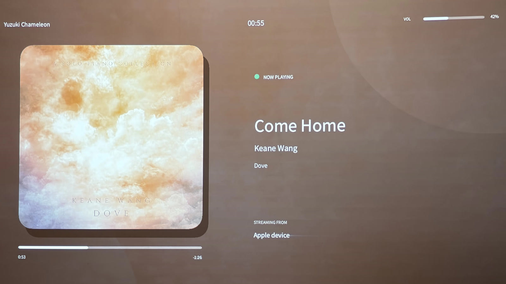

# Yuzuki Chameleon AirPlay Receiver

English · [简体中文](README.zh-CN.md)

Turn a Yuzuki Chameleon (Allwinner H616) into an AirPlay 1 audio receiver. Choose between the 3.5 mm jack and HDMI audio, and show album art, track information, and playback progress on an HDMI monitor.




Board photo from [YuzukiHD/YuzukiChameleon](https://github.com/YuzukiHD/YuzukiChameleon/blob/master/Bitmap/main.jpeg).

## Requirements

- A booted [Yuzuki Chameleon](https://github.com/YuzukiHD/YuzukiChameleon) running Tina Linux with `/etc/rc.common` and the vendor ALSA drivers. The original setup used `tina_h616-yuzukichameleon_uart0` with Linux 4.9.170.
- An AirPlay sender and the board on the same reachable LAN. Use USB ADB or an existing SSH connection for deployment.
- A 32-bit ARM hard-float Linux toolchain with a libc compatible with the target root filesystem. The original image uses `/lib/ld-linux-armhf.so.3`. Armbian uses a different device tree, sound card layout, and init system.

## Build

On a Linux host, build the project tools and check the init scripts:

```sh
make -j4 check
```

For the board, put the Tina SDK toolchain's `bin` directory on `PATH`, set up the SDK environment, and run:

```sh
make -j4 CROSS_COMPILE=arm-openwrt-linux-gnueabi- BUILD_DIR=build/tina check
file build/tina/*
```

`nowplaying` draws the HDMI display, and `yuzuki-admin` serves the optional control page. Run `fbmode` without arguments to inspect the framebuffer's visible size, virtual size, and pixel format.

### Shairport Sync

Download [Shairport Sync 3.3.8](https://github.com/mikebrady/shairport-sync/archive/refs/tags/3.3.8.tar.gz). The SDK needs target development libraries for ALSA, libconfig, popt, and OpenSSL. The host needs Autoconf, Automake, and pkg-config. From the extracted source directory, using the same SDK environment:

```sh
patch -p1 < /path/to/yuzuki-chameleon/patches/shairport-sync-3.3.8-mdns.patch
autoreconf -fi

# Configure pkg-config to use the target SDK libraries.
./configure --host=arm-openwrt-linux-gnueabi \
  --with-alsa --with-ssl=openssl --with-tinysvcmdns --with-metadata \
  --without-libdaemon --without-systemd --without-soxr --without-configfiles
make -j4
```

The patch also fixes duplicate Automake initialization in 3.3.8. If the compiler cannot find the SDK headers, check `PKG_CONFIG_LIBDIR` and `PKG_CONFIG_SYSROOT_DIR`, and supply include paths through `CPPFLAGS` if needed. Link against libraries available on the board, or statically link the dependencies from the target SDK. On the board, check that `shairport-sync -V` runs and lists `ALSA`, `tinysvcmdns`, and `metadata`.

## Deploy to Tina

Back up existing files at the destinations below. Ensure only one Shairport Sync service starts at boot so the services do not compete for the same PCM. Transfer files using ADB or SCP. Set binaries and scripts to mode `0755` and configuration files and the font to `0644`.

| Local file | Destination on the board |
| --- | --- |
| Built `shairport-sync` | `/usr/bin/shairport-sync` |
| `board/shairport-sync.conf` | `/etc/shairport-sync.conf` |
| `board/shairport-alsa.conf` | `/etc/asound.conf` for a fresh install using the 3.5 mm jack |
| `board/airplay_boot.init` | `/etc/init.d/airplay_boot` |
| `board/yuzuki-admin.conf` | `/etc/yuzuki-admin.conf`. Keep the existing file if present. |
| `build/tina/nowplaying` | `/usr/bin/nowplaying` |
| `nowplaying/nowplaying.init` | `/etc/init.d/nowplaying` |
| A TrueType or OpenType font | `/usr/share/nowplaying/nowplaying.ttf` |
| `webadmin/hdmi-audio-recovery` | `/usr/bin/hdmi-audio-recovery` |
| `webadmin/hdmi-audio-recovery.init` | `/etc/init.d/hdmi-audio-recovery` |

For example, Ubuntu's Noto CJK package provides `NotoSansCJK-Regular.ttc`. The renderer uses the first face in the collection. For an audio-only setup, skip the renderer, its init script, and the font.

Use the [boot order example](board/load_script.conf) to add `nowplaying`, `airplay_boot`, and `hdmi-audio-recovery` in that order to the board's existing `/etc/init.d/load_script.conf`. Keep the image's existing entries and add only the services you installed. Reboot and select **Yuzuki Chameleon** on an Apple device on the same LAN. A fresh install defaults to the 3.5 mm jack.

`airplay_boot` uses the image's `wlan0`, XR829 driver, and Wi-Fi configuration. Set your credentials on the board. If Dropbear is already installed, the script can start SSH with key-only authentication. Configure your own authorized public key.

### Optional web controls

The web page switches between the 3.5 mm jack and HDMI and toggles the now-playing renderer. It runs as root, listens on all IPv4 interfaces, and has no authentication. The example boot list leaves it disabled. Enable it only on an isolated, trusted LAN.

Install `build/tina/yuzuki-admin` as `/usr/bin/yuzuki-admin` and `webadmin/yuzuki-admin.init` as `/etc/init.d/yuzuki-admin`. Make both executable. Add `yuzuki-admin` after `airplay_boot` in the boot list, or start it manually:

```sh
/bin/ash /etc/rc.common /etc/init.d/yuzuki-admin start
```

Open port `8080` on the board's IP address in your browser. With USB ADB, run `adb forward tcp:18080 tcp:8080` and open `http://127.0.0.1:18080/`.

Applying settings restarts Shairport. Turning off the renderer can leave the HDMI signal and last frame visible. To configure HDMI from the shell, set `audio=hdmi` in `/etc/yuzuki-admin.conf`, set the `pcm.airplay` hardware device to `hw:2,0` and the `ctl.airplay` card to `2` in `/etc/asound.conf`, then reboot.

## Troubleshooting

- **Analog audio.** The vendor image exposes the codec as `hw:0,0`. The ALSA `plug` PCM resamples the 44.1 kHz stream to 48 kHz. The configuration uses software volume and keeps the DAC powered to reduce pops when playback starts or stops. This keeps the PCM open while idle.
- **HDMI audio.** This Tina image uses the AHUB Media Stream `hw:2,0` and routes `APBIF_TXDIF0` to I²S1. If a monitor change leaves the stream in `XRUN`, the recovery service resets the route and has Shairport reopen the PCM. Check card numbers with `aplay -l`.
- **Discovery.** The TinySVCmDNS patch corrects resource record name handling and retains questions when the parser cannot read a query's known-answer section. The boot script waits for an IPv4 address before launching Shairport.
- **Display resolution.** The renderer draws at the native resolution exposed by `/dev/fb0`. Native 1080p on the test board required a separate 1920×1080 framebuffer configuration for the Tina image. Modified boot packages are outside this repository. A 1080p signal at the monitor can still come from an upscaled framebuffer.
- **Latency and sync.** The configuration disables Shairport's synchronization correction for single-receiver playback. Sender buffering still applies. Artwork and progress depend on the metadata the sender provides.
- **Wi-Fi.** The XR829 on the test board needed firmware compatible with its 40 MHz board data. If it can scan but cannot associate, check the image, board revision, and vendor firmware.

## License

Original code and documentation are available under the [MIT License](LICENSE). See [Third-party components](third_party/README.md) for their licenses and notices. The release includes source code, documentation, and a demo photo. Obtain firmware, OS images, fonts, and compiled dependencies separately.
