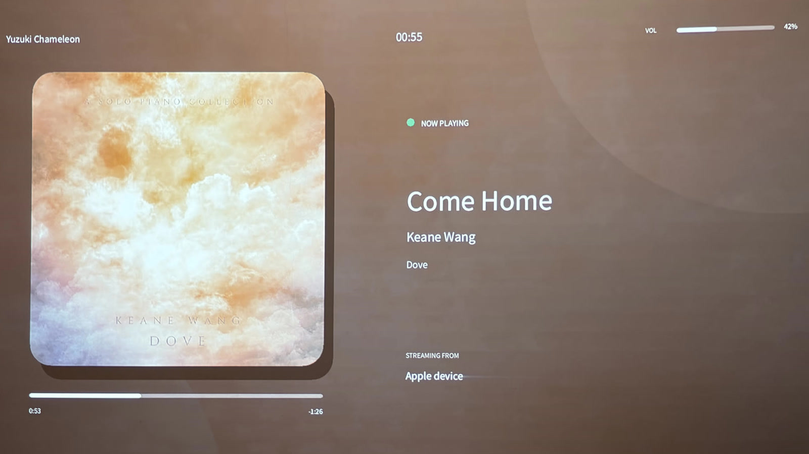

# Yuzuki Chameleon AirPlay 接收器

[English](README.md) · 简体中文

把 Yuzuki Chameleon（Allwinner H616）变成 AirPlay 音频接收器。支持 3.5 mm 模拟输出和 HDMI 音频，可在 HDMI 屏幕上显示封面、曲名、歌手和进度。




开发板照片来源为 [YuzukiHD/YuzukiChameleon](https://github.com/YuzukiHD/YuzukiChameleon/blob/master/Bitmap/main.jpeg)。

## 适用环境

- 已启动的 [Yuzuki Chameleon](https://github.com/YuzukiHD/YuzukiChameleon)，运行带 `/etc/rc.common` 和厂商 ALSA 驱动的 Tina Linux 镜像。本项目使用的镜像是 `tina_h616-yuzukichameleon_uart0`，内核版本为 4.9.170。
- 板子已联网，发送端与接收器在可互通的局域网。部署可用 USB ADB 或已配置的 SSH。
- 使用与目标 rootfs 匹配的 32 位 ARM hard-float Linux 用户态工具链。原镜像的可执行文件使用 `/lib/ld-linux-armhf.so.3`。SDK 的 libc 版本也需要匹配。Armbian 的设备树、声卡和服务布局不同。

## 构建

在 Linux 主机上构建并检查本项目的程序和 init 脚本：

```sh
make -j4 check
```

使用 Tina SDK 的工具链构建板端二进制。先把 SDK 工具链的 `bin` 加入 `PATH`，并按该 SDK 的要求设置环境，再执行：

```sh
make -j4 CROSS_COMPILE=arm-openwrt-linux-gnueabi- BUILD_DIR=build/tina check
file build/tina/*
```

`nowplaying` 和 `yuzuki-admin` 是运行组件，`fbmode` 是 framebuffer 诊断工具。直接运行 `fbmode` 可查询可见尺寸、虚拟尺寸和像素格式。

### Shairport Sync

准备 [Shairport Sync 3.3.8 源码](https://github.com/mikebrady/shairport-sync/archive/refs/tags/3.3.8.tar.gz)，以及 SDK 目标架构的 ALSA、libconfig、popt 和 OpenSSL 开发库。宿主需要 Autoconf、Automake 和 pkg-config。在解压后的源码目录里，使用前面同一套 SDK 环境：

```sh
patch -p1 < /path/to/yuzuki-chameleon/patches/shairport-sync-3.3.8-mdns.patch
autoreconf -fi

# SDK 的 pkg-config 配置应指向目标架构库。
./configure --host=arm-openwrt-linux-gnueabi \
  --with-alsa --with-ssl=openssl --with-tinysvcmdns --with-metadata \
  --without-libdaemon --without-systemd --without-soxr --without-configfiles
make -j4
```

补丁同时修正了 3.3.8 的重复 Automake 初始化。交叉编译时若找不到头文件，可用 `CPPFLAGS` 指定 SDK 的头文件目录，并检查 `PKG_CONFIG_LIBDIR` 与 `PKG_CONFIG_SYSROOT_DIR`。所用库须存在于板上，或从目标 SDK 静态链接。检查板端 `shairport-sync -V` 能运行，且输出含 `ALSA`、`tinysvcmdns` 和 `metadata`。

## 部署到已启动的 Tina

先备份板上同名文件，并确认没有第二个 Shairport Sync 开机服务抢占 PCM。通过 ADB 或 SCP 传输文件，再按下表放到板上的目标位置。二进制和脚本权限设为 `0755`，配置和字体设为 `0644`。

| 本地文件 | 板上路径 |
| --- | --- |
| 构建好的 `shairport-sync` | `/usr/bin/shairport-sync` |
| `board/shairport-sync.conf` | `/etc/shairport-sync.conf` |
| `board/shairport-alsa.conf` | `/etc/asound.conf`，首次装机用的模拟声卡配置 |
| `board/airplay_boot.init` | `/etc/init.d/airplay_boot` |
| `board/yuzuki-admin.conf` | `/etc/yuzuki-admin.conf`，已有配置应保留 |
| `build/tina/nowplaying` | `/usr/bin/nowplaying` |
| `nowplaying/nowplaying.init` | `/etc/init.d/nowplaying` |
| 自备 TrueType 或 OpenType 字体 | `/usr/share/nowplaying/nowplaying.ttf` |
| `webadmin/hdmi-audio-recovery` | `/usr/bin/hdmi-audio-recovery` |
| `webadmin/hdmi-audio-recovery.init` | `/etc/init.d/hdmi-audio-recovery` |

例如，Ubuntu 上的 Noto CJK 字体包提供 `NotoSansCJK-Regular.ttc`，可复制到表中的字体路径。字体渲染器会使用集合中的第一套字形。只需要音频时可跳过播放器、播放器 init 和字体。

参考 [启动顺序](board/load_script.conf)，把 `nowplaying`、`airplay_boot` 和 `hdmi-audio-recovery` 按顺序合并到板上原有的 `/etc/init.d/load_script.conf`。只添加已安装的服务，保留镜像原来的其余条目。重启后，在同一个局域网的 Apple 设备上选择 **Yuzuki Chameleon**。初次安装默认走 3.5 mm。

`airplay_boot` 使用原镜像的 `wlan0`、XR829 驱动和板端 Wi‑Fi 配置。请在设备上配置自己的凭据。镜像已有 Dropbear 时，脚本可启动仅用密钥登录的 SSH，公钥需由设备所有者配置。

### 可选 Web 管理页

管理页可切换 3.5 mm 或 HDMI，并开关播放画面。它以 root 运行，监听所有 IPv4 接口，无登录认证。默认的启动清单未启用它。只在隔离、可信的局域网内启用。

将 `build/tina/yuzuki-admin` 放到 `/usr/bin/yuzuki-admin`，将 `webadmin/yuzuki-admin.init` 放到 `/etc/init.d/yuzuki-admin`，并为二者设置执行权限。要开机启动，在列表中把 `yuzuki-admin` 插入到 `airplay_boot` 后。手动启动可用 `/bin/ash /etc/rc.common /etc/init.d/yuzuki-admin start`。浏览器访问 `http://<板子IP>:8080/`，或用 `adb forward tcp:18080 tcp:8080` 后访问 `http://127.0.0.1:18080/`。

应用设置会重启 Shairport。关闭播放画面会停止渲染服务，HDMI 信号和当前画面可能仍然保留。也可通过设备终端配置 HDMI。在 `/etc/yuzuki-admin.conf` 中设置 `audio=hdmi`，将 `/etc/asound.conf` 的 `pcm.airplay` 从 `hw:0,0` 改为 `hw:2,0`，并将 `ctl.airplay` 的 `card` 改为 `2`，然后重启板子。

## 板端排查笔记

- **模拟输出**。厂商镜像上的编码器为 `hw:0,0`。AirPlay 的 44.1 kHz 音频经 ALSA `plug` 重采样为 48 kHz。配置使用软件音量和较窄的衰减范围，并让 DAC 在空闲时保持开启，以减轻播放起停的爆音。这会持续占用选定的 PCM。
- **HDMI 输出**。这版 Tina 上配置的是 AHUB 的 Media Stream `hw:2,0`，并将 `APBIF_TXDIF0` 接到 I²S1。更换屏幕后若状态持续为 `XRUN`，恢复服务会重设路由并让 Shairport 重开 PCM。声卡编号可用 `aplay -l` 核对。
- **发现设备**。旧版 TinySVCmDNS 的已知应答处理可能导致 AirPlay 发现间歇失效。仓库中的补丁恢复 RR 名称偏移处理，并在查询的已知应答无法解析时保留已解析的问题。启动脚本在取得 IPv4 地址后才启动 Shairport。
- **分辨率**。渲染器按 `/dev/fb0` 提供的原生分辨率绘制。实验板的 1080p 需要该镜像额外配置 1920×1080 framebuffer。仓库未附带修改过的启动包。仅凭显示器显示 1080p 输入，无法判断应用是否实际使用 1080p framebuffer。
- **延迟和同步**。这套配置针对单接收器播放，关闭了 Shairport 的同步校正。发送端缓冲仍然存在。进度和封面取决于发送端提供的元数据。
- **Wi‑Fi**。实验板的 XR829 对固件及 40 MHz 板级数据匹配敏感。如果能扫描到 AP 却无法关联，应先核对镜像、板卡和厂商固件版本。

## 许可证

项目原创代码和文档采用 [MIT](LICENSE)。第三方组件保留各自的许可证和声明。发布包包含源码、文档和实机照片。Tina 镜像、设备固件、字体和预编译依赖需另行获取。参见 [第三方组件](third_party/README.md)。
